# GuidingHand: development handoff for Meta coding agents

Read this file before editing the repository. It is a map of the current code, not a product pitch.
When this file conflicts with source code, tests, or a newer dated handoff, verify the code and update
this file in the same change.

Start with [AGENTS.md](AGENTS.md) and [the current development state](docs/current-development-state.md).
Documentation maintenance is a required completion step, not optional cleanup. Follow the README,
component-map, current-state and dated-handoff update rules in AGENTS.md before handing work back.

## 1. Product in one paragraph

GuidingHand is an Android accessibility coach for older adults. The elder can tap the floating
**Help / Giúp** control over the app they are already using, speak a goal, review the transcript, and
receive one short spoken instruction plus one visual target at a time. The elder performs every
operation in the target app. GuidingHand observes the new screen, verifies progress, and either gives
the next step, asks one clarification question, or stops safely.

The product is bilingual (Vietnamese and English), uses respectful forms of address, and is designed
for poor vision and shaky hands. Its optional young-helper mascot is a fictional GuidingHand assistant;
it must never claim to be a real grandchild or family member.

## 2. Non-negotiable behavior

Do not optimize away any rule in this section.

1. **The elder acts.** Runtime code must never auto-tap, auto-type, auto-paste, auto-swipe,
   auto-send, auto-confirm, place a call, make a purchase, or enter a password, OTP, or payment detail.
2. **Safety precedes providers.** Run the native safety gate before capture, transcription, Spark, SAM,
   and speech output. Password, OTP, and payment screens latch a hard pause and clear guidance.
3. **Uncertainty stops.** An incomplete, cluttered, stale, ambiguous, or mismatched screen is not a
   sensitive screen, but it still must stop and ask rather than guess.
4. **One immutable snapshot.** Spark and SAM receive the exact same safety-checked screenshot bytes.
   Do not capture a second image between planning and segmentation and do not continuously capture.
5. **One model interface.** Production uses `GuideModel` -> `CoreBackendModel`. `MockModel` exists only
   in the debug source set as an explicit development stand-in; release never selects it.
6. **One step at a time.** Present one short instruction, one target, then wait for a real screen change.
   A wrong tap keeps the goal and replans from the resulting state; it never restarts from Home.
7. **No invented target.** A production ring requires a Spark-selected live Accessibility node, a SAM
   3.1 region from the same frame, and native target fusion. Failure of any source means no ring.
8. **Speech roles are fixed.** `muse-voice-transcribe-1.0` is input only. Speech output is Android
   system TTS, offline where available, at rate `0.85`.
9. **Keys stay server-side.** Never place `MODEL_API_KEY`, an app-session token, or any provider key in
   Kotlin, resources, an APK, logs, screenshots, committed files, prompts, or test fixtures.
10. **Evidence must be honest.** Deterministic tests are not real-phone success, installation is not a
    user interaction pass, and a demo is not older-adult usability research. Use `TBD` when unmeasured.

The only permitted convenience action is an explicit **Mở giúp tôi / Open for me** control at a
verified launcher step, after the elder taps it. It may launch that installed app's launcher activity.
It grants no permission to act inside the target app. A sensitive pause may open `ACTION_DIAL` after
the elder chooses **Call family**; it must never use `ACTION_CALL` or place the call.

## 3. Current repository truth

- Repository: `E:/Hackathon/GuidingHand`
- Active integration branch: `main`
- Android namespace and original package: `vn.guidinghand`
- Side-by-side debug Candidate package: `vn.guidinghand.candidate`
- Current source version at this handoff: `1.5.55`, Android code `64`; verify app/build.gradle.kts before relying on this value
- Candidate build label: `GuidingHand Candidate`
- Android: Kotlin, Jetpack Compose, min SDK 30, target/compile SDK 36, Java 17
- Backend: Python 3.12, WSGI/Gunicorn, standard-library HTTP orchestration
- Provider planner: `muse-spark-1.3` with `reasoning_effort=minimal`
- Region source: SAM 3.1 through `meta-sam-parser`
- Speech input: `muse-voice-transcribe-1.0`
- Speech output: Android system TTS at `0.85`
- Total authorized Meta budget ceiling: USD 150 including prior usage; never reset its persisted ledger
- Local USB development ports: original `8766`, Candidate `8768`
- A Candidate build honors a stored `http://127.0.0.1` loopback URL only when the explicit dev-USB-bridge flag is set; without it, a stale loopback falls back to the cloud default instead of failing against a dead cable.

Historical files under `phase1/` are reference material, not the active Android implementation.
Some dated handoffs record older branches, versions, and phone observations. The active source under
`app/src/` and `backend/`, current tests, `git log`, and this document take precedence for development.

## 4. System loop

```mermaid
flowchart LR
    Elder["Elder taps Help and speaks"] --> Voice["VoiceActivity: record, then close mic window"]
    Voice --> Read["GuidingHandService reads Accessibility tree"]
    STT --> Review["User reviews transcript"]
    Review --> Engine["GuideEngine keeps goal, dialogue and verified progress"]
    Read --> Gate{"Native safety and freshness gate"}
    Gate -->|"Safe; pending recording"| STT["Own backend: Muse Voice Transcribe"]
    Gate -->|"Safe; continuing task"| Engine
    Engine --> Shot["One on-demand screenshot + UI nodes + hash"]
    Shot --> Spark["Muse Spark plans one step or one question"]
    Spark -->|same image bytes| SAM["SAM 3.1 segments chosen target"]
    SAM --> Fuse["Native Spark + SAM + live-node fusion"]
    Fuse --> TTS["Android TTS speaks at 0.85"]
    TTS --> UI["Attached solid card + non-touchable double ring"]
    UI --> ElderTap["Elder taps or navigates"]
    ElderTap --> Read
    Gate -->|cannot read or unsure| Ask["Stop and ask; never guess"]
    Ask --> Voice
    Gate -->|password / OTP / payment| Pause["Latched hard stop; clear ring"]
```



The client currently sends the safety-checked image and UI data in one `/core/step` request. The
backend validates the snapshot, calls Spark, revalidates the same binding, then gives the same image
to SAM. The Android client rejects the result if the live screen changed while the models were working.

## 5. Android component map

All active Kotlin files are under `app/src/main/java/vn/guidinghand/` unless noted.

| Component | Responsibility | Important invariant |
| --- | --- | --- |
| `GuidingHandService.kt` | `AccessibilityService`; reads windows, owns the session, mic lease, capture, overlay, and event coalescing | Never dispatch target-app gestures or input |
| `GuideEngine.kt` | Real state machine for goal, clarifications, task data, verification, wrong-tap recovery, stale-result rejection | Only Stop/new goal/lock/sensitive state clears task memory |
| `GuideData.kt` | Shared data contracts, safety policy, decisions, statuses, task/evidence types | Keep decisions typed; do not replace with keyword scripts |
| `CoreBackendModel.kt` | Sole production `GuideModel`; serializes safe screen data, captures once, calls backend, validates binding/language/SAM | Same bitmap bytes for Spark and SAM; reject stale replies |
| `GuideOverlay.kt` | Floating Help anchor, attached card, companion-led transcript review, ring/pointer, actions, rendering deduplication | Card remains attached to Help; transcript review opens at the first line; ring is non-touchable |
| `GuidePanelLayout.kt` | Card/voice placement, target fusion geometry, edge handling, transcript presentation | Edge controls are valid when fusion agrees; do not reject merely for being near an edge |
| `VoiceActivity.kt` | Focusable mic/transcript window, recording, transcript editing and confirmation | The transcript is reviewed before task input; no duplicate `Listening…` overlay |
| `VoiceWindowLease.kt` | Ensures only one voice window owns the overlay-suppression lease | A stale close cannot release a newer window's lease |
| `SpeechInputClient.kt` | Uploads bounded audio to `/core/transcribe` | Requires consent and session authentication |
| `SystemSpeechOutput.kt` | Local Android TTS output | Rate is `0.85`; Muse Transcribe is never used as TTS |
| `GuideDesign.kt` | Accessible dimensions, colors and contrast constants | Preserve documented minimum text/target sizes and >= 7:1 instruction contrast |
| `FamilyPreferences.kt` | Language, address, tone, vision profile, card size, mascot, consent and backend settings | Settings auto-save; no redundant Save button |
| `RespectfulLanguage.kt` | Preset/custom respectful narration, help label and microphone question | Keep user and assistant roles distinct; do not rewrite action labels, dictated content or names |
| `CompanionDrawable.kt` / `FamilyPortrait.kt` | Finite companion gestures and address-based Home illustration | Respect reduced motion; custom names do not imply age/gender |
| `GuideSurfaces.kt` | Shared opaque surfaces with decorative highlights | Never compromise text contrast or change the owner's padding/anchor |
| `SpokenLanguagePolicy.kt` / `OutputLanguagePolicy.kt` | Detects clear spoken language changes and rejects mixed/wrong provider output | Vietnamese mode is Vietnamese; English mode is English except names/app labels |
| `InstalledApps.kt` | Reads installed launcher apps and default browser | Coordinates are always from the current live screen |
| `ExactScreenDecisionCache.kt` | RAM-only exact-screen step cache | Exact state only, 30-second TTL, cleared on safety/session boundaries |
| `GuideTrace.kt` | Bounded content-free technical events and timings | Never log screenshots, audio, goals, names, messages, tokens, or keys |
| `MainActivity.kt` | Setup and preferences UI | Everyday help starts from the floating control, not by typing in this activity |
| `BackendEndpoint.kt` | Accepts production HTTPS or explicit debug USB loopback only | Release must not accept insecure arbitrary HTTP |
| `DeviceVisibility.kt` | Lock/visibility gate | Floating guidance is hidden on the lock screen |
| `TemporaryClipboard.kt` | Explicitly consented temporary draft copy support | Never paste or send; clear owned content promptly |

Build-source selection:

- `app/src/release/.../GuideModelFactory.kt` always creates `CoreBackendModel`.
- `app/src/debug/.../GuideModelFactory.kt` may create `MockModel` only when the explicit development
  preference is enabled. It is not a parallel fast path or automatic fallback.
- `app/src/debug/.../MockModel.kt` must remain clearly development-only.

### Guide state machine

`GuideStatus` includes `IDLE`, `READING`, `PLANNING`, `CLARIFYING`, `CONFIRMING_INPUT`,
`CONFIRMING_COPY`, `WAITING_TAP`, `WAITING_NAVIGATION`, `VERIFYING`, `RECOVERING`,
`SAFETY_PAUSED`, `ASKING`, `UNAVAILABLE`, `UNSUPPORTED`, and `DONE`.

A tap that leaves `VERIFYING` unchanged past `VERIFY_TIMEOUT_MS` (15s) concludes with an explicit `ASK` naming the retry instead of waiting silently. The clock is injected (`nowElapsed`, default `monotimeMs`) so plain JVM unit tests stay hermetic.

`GuideDecision` is the only model-facing decision surface: `Step`, `Clarify`, `Unsupported`,
`Unavailable`, `Sensitive`, `Await`, `Navigate`, `DoneProposal`, or `StateChanged`. Do not add an
execution/tool-call decision that performs an Android action for the elder.

The general task kind is `guide_app`. The strict Zalo photo task retains specialized evidence checks.
General model-planned guidance across readable installed apps exists in source, but this is not proof
that every app or workflow has passed on a real phone.

## 6. Backend component map

All backend files are under `backend/`.

| Component | Responsibility |
| --- | --- |
| `core.py` | Input validation, safety recheck, Spark prompt/parse, immutable snapshot binding, SAM call/parse, WSGI app |
| `speech_input.py` | Audio validation and Muse Voice Transcribe adapter |
| `gateway.py` | Local development server plus shared budget implementations, including production Firestore accounting |
| `test_firestore_sdk.py` | Real pinned Firestore SDK behavior with mocked network calls; reservation/settlement regressions |
| `pair_phone.py` | Temporary USB pairing and `adb reverse`, or an authenticated debug switch back to the default Cloud URL; never transfers the Meta key to Android |
| `Dockerfile` | Production-shaped Gunicorn container; expects HTTPS termination in front |
| `test_core.py` | Core safety, snapshot, Spark/SAM and response-contract tests |
| `test_speech_input.py` | Transcription request and validation tests |
| `test_cross_app.py` / `test_goal_guidance.py` | General goal and multi-app contract fixtures |
| `generate_evaluation_report.py` | Deterministic safety/fusion evidence; provider calls must remain zero |
| `generate_meta_trace_viewer.py` | Privacy-bounded Meta timing/state trace report |
| `collect_phone_evidence.py` | Phone evidence collection without claiming user interaction |

Public backend contract:

- `GET /health`: unauthenticated liveness only; reveals no model/key/budget details.
- `GET /core/capabilities`: authenticated capability contract.
- `POST /core/transcribe`: authenticated Muse Voice Transcribe input.
- `POST /core/step`: authenticated Spark -> SAM core step.

Production accepts HTTPS only. The temporary `gateway.py` server binds to loopback and is a USB
development path, not the product architecture.

### Secret and budget handling

- `backend/.env` is ignored. Never display, print, commit, or copy its values into documentation.
- `backend/.env.example` contains names and safe defaults only.
- `MODEL_API_KEY` exists only in the backend environment.
- `GUIDINGHAND_APP_SESSION_TOKEN` authenticates the app to our backend; it is not a Meta key.
- Budget state lives under `backend/.state/` locally; deployed Cloud Run uses a persistent Firestore ledger. See docs/cloud-deployment.md.
- Never delete/reset that state to regain budget. The total ceiling must stay at or below USD 150.
- Tests use fixtures and must not make billed provider calls unless a human explicitly requests a
  bounded live check and the result is recorded separately.

## 7. UI and accessibility contract

- Instruction text: at least `24sp`; button labels: at least `22sp`; body: at least `20sp`.
- Primary touch target: at least `72dp`; secondary target: at least `48dp`.
- Solid cream card with dark green text; instruction contrast must remain at least `7:1`.
- The card follows and touches the draggable Help anchor. It must not fall back to a detached bottom
  sheet, cover its target, keyboard, or system bars; collapse when a safe full card cannot fit.
- Ring: black outer border plus bright-yellow inner border, each at least `6dp`, with at least `12dp`
  target padding. It is `FLAG_NOT_TOUCHABLE` and never replaces the elder's tap.
- Never use color alone, red for wrong taps, or a red/green or blue distinction as the only cue.
- Background animation must not create an endless wait. Take at most two bounded frames back-to-back
  with no fixed settling delay. If the safe app/window/actionable tree and interaction generation are
  unchanged, freeze the second frame even when decorative pixels move. A click, selection, text edit,
  scroll, window change, unsafe state, or actionable-tree change invalidates it. Spark and SAM still
  share that exact frozen image.
- The voice window is compact, appears beside Help on its first visible frame, and suppresses every
  accessibility overlay while its lease is active. There must be no secondary blinking `Listening…`
  pill and no first-frame jump to the bottom.
- Explicit Cancel discards local input and dismisses the intake to Help without a new notice card.
  A latched safety pause takes precedence. Preserve the task; starting intake again clears the visual
  dismissal flag. Typing gets the flexible row width; Cancel wraps its label with an 80dp minimum.
- Transcript review opens at its first line rather than auto-scrolling to the end. The selected
  companion introduces the review with the saved forms of address. Android offline TTS reads the
  complete transcript once and asks for confirmation. This local playback is not a provider call;
  dictated words remain verbatim, and fixed review actions stay outside the scroll lane.

See `docs/elder-ui-contract-2026-10-30.md` and
`docs/elder-ux-regression-checklist-2026-11-01.md` before changing UI behavior.

## 8. Development workflow

### Before editing

1. Read AGENTS.md, this file, docs/current-development-state.md, `README.md`, and the most recent section at the bottom of
   `docs/continuation-handoff-2026-10-28.md`.
2. Run `git status --short --branch`. Preserve all user changes and do not reset or discard them.
3. Inspect the actual implementation and its tests. Do not infer components from product prose.
4. Write acceptance criteria before a non-trivial UX, safety, or state-machine change.

### Required deterministic verification

From the repository root on Windows PowerShell:

```powershell
python -m unittest discover -s backend -p 'test_*.py' -v
./gradlew.bat testDebugUnitTest lintDebug assembleDebug -PcandidateBuild=true --no-daemon --console=plain
python backend/generate_evaluation_report.py --output build/outputs/deterministic-evaluation.md
git diff --check
```

The Candidate flag is mandatory. Without `-PcandidateBuild=true`, the debug APK can use the original
`vn.guidinghand` identity and must not be installed as the side-by-side candidate.

### Local development backend

Check configuration without revealing values:

```powershell
python backend/gateway.py --check
```

Run the temporary Candidate gateway:

```powershell
python backend/gateway.py --port 8768
```

In a second terminal, with an authorized device connected:

```powershell
adb devices -l
python backend/pair_phone.py --serial <DEVICE_SERIAL> --candidate
```

Return a paired Candidate to the default Cloud Run URL without clearing its app-session token or
other user setup:

```powershell
python backend/pair_phone.py --serial <DEVICE_SERIAL> --candidate --cloud
```

The saved token must be the Cloud backend's app-session token. A local gateway token is intentionally
rejected by Cloud Run and must be replaced in Settings; neither command reads the Meta provider key.

Do not put the device serial in committed documentation or evidence. Pairing configures only the
app-session token and loopback endpoint. Microphone and screen-sharing consent still require the
person on the phone.

### Candidate install and read-only smoke test

```powershell
./gradlew.bat assembleDebug -PcandidateBuild=true --no-daemon --console=plain
powershell -ExecutionPolicy Bypass -File tools/phone-smoke-test.ps1 -InstallCandidate
```

The smoke script verifies identity, Accessibility binding, awake/unlocked state, new fatal exceptions,
and idle overlay churn. It does not tap controls and must not be reported as a task pass. Use
`-CaptureSafeScreen` only when the foreground package is Xiaomi Home or GuidingHand Candidate.

This Xiaomi has historically rejected ADB input injection with `INJECT_EVENTS`. Do not retry or bypass
that policy. A real interaction test requires the user to tap and speak.

## 9. Change discipline

- Work on `main` unless the user explicitly chooses another branch.
- The user has allowed commits and pushes to `main`, but only after all relevant gates pass.
- Do not merge unrelated historical branches.
- Do not replace or uninstall the original `vn.guidinghand` package. Update only the Candidate package
  during development unless the user explicitly requests a production replacement.
- Use `apply_patch` for source/document edits. Preserve unrelated dirty-worktree changes.
- Never use destructive Git commands such as `git reset --hard` or `git checkout --` on user work.
- Do not invent test counts, latency, ring accuracy, usability scores, provider wiring, or phone passes.
- Record deterministic, synthetic, provider-live, read-only-phone, and user-driven evidence as distinct
  evidence types.
- Update this document when component boundaries, safety rules, commands, or model roles change.
- Complete the documentation checklist in AGENTS.md in the same commit as the relevant change.
  Record whether README changed or was reviewed without a public-facing change.

## 10. Known current status and next verification

The maintained snapshot is [docs/current-development-state.md](docs/current-development-state.md).
For source 1.5.51/code 60, 96 backend tests and 125 Android tests, lint and Candidate assemble passed.
Candidate 1.5.51 was installed on Xiaomi. Its read-only smoke check found the phone awake/unlocked,
Accessibility enabled/not crashed, stable idle overlay, and no new fatal exception. Safe-group latency
work: event coalescing 120→80ms, Settings debounce 450→250ms, per-step image-decode cache on the
step frame, and an elapsed-seconds line on busy cards. This is not a person-driven speech or task pass.
Cloud-connected transcription was previously confirmed by the user after the Firestore fix.

Still requiring person-driven verification:

1. The microphone window's first visible frame is anchored beside Help and does not jump downward.
2. No duplicate or blinking `Listening…` overlay appears while recording.
3. The compact microphone sheet remains readable and balanced at the selected card/text sizes.
4. The guide card stays attached to Help after transcription and during movement.
5. Vietnamese and English speech produce same-language transcript review, guidance, buttons, and TTS.
   Confirm that a long review starts at the first line and that the companion reads it exactly once.
6. A benign Chrome page does not trigger a false sensitive-screen hard stop.
7. Wrong-tap recovery keeps the goal and continues from the actual new screen.
8. Password/OTP/payment screens pause before any provider call; do not enter real sensitive data.
9. Ring accuracy, per-step latency, and older-adult usability remain `TBD` until measured honestly.

## 11. Recommended first prompt for a Meta coding session

```text
Open E:/Hackathon/GuidingHand. Read AGENTS.md, META_DEVELOPMENT.md and
docs/current-development-state.md before acting. Then read the
actual files relevant to my request and their tests. Preserve every non-negotiable safety invariant,
keep provider keys server-side, distinguish deterministic evidence from real-phone evidence, and do
not claim a pass you did not observe. Show me the intended acceptance criteria before making a
non-trivial UX, state-machine, safety, or model-contract change. Review/update README and affected
documentation in the same change, update the current-state snapshot, and append the dated handoff
with actual checks, installed/deployed status, blockers and the next action.
```
