# GuidingHand

**A little guidance. Your own independence.**

GuidingHand helps older adults use their Android phones one step at a time. Tap the floating **Help** bubble over the app already in use, say what you want to do, and receive a short spoken instruction with a ring around the next control. You perform the action; GuidingHand observes what changed and guides the next step.

Built with **Muse Spark**, **SAM 3.1**, and **Muse Voice Transcribe**, through GuidingHand's own HTTPS backend.

## Why GuidingHand exists

A phone can be a connection to family, information, and everyday services. Small controls, unfamiliar screens, and long sequences of steps can make that connection difficult to use independently. Family members cannot always be beside someone when they need help.

GuidingHand brings patient, contextual guidance to the screen where help is needed. Its purpose is to help someone understand and carry out the next action while keeping control of their phone. The optional young-helper character represents a fictional assistant, never an actual grandchild or family member.

GuidingHand has two horizons: in the short term, it offers calm, one-step guidance for the task in front of the person; in the long term, the repeated explanations of where to look and what each action does help build confidence and intuition for using a phone independently. It never taps or acts on the person's behalf.

## How it works

1. **Ask from the current screen.** Tap Help, record a request, then stop recording. There is no need to open GuidingHand or type first.
2. **Review what was heard.** The companion shows a short transcript at once; a longer one is divided into numbered pages with large Back and Next controls, so reading it does not depend on discovering a swipe gesture. The complete sentence is read aloud once with offline Android TTS. You can use it, edit it, or record again. If intent, recipient, or content is unclear, the assistant asks one question at a time.
3. **Follow one step.** A solid guide card stays beside Help. A spoken sentence and a non-touchable ring identify the next action. The card can collapse, and dragging Help moves its attached card.
4. **Act at your own pace.** You tap, type, swipe, and make final decisions yourself. Repeat the instruction or stop whenever needed.
5. **Continue from what happened.** GuidingHand reads the resulting screen, checks progress, and keeps the goal after a wrong tap instead of restarting from Home.

Guidance is planned from the current screen and goal across installed apps, rather than a fixed script for each app. Compatibility depends on screen readability, available controls, model results, and Android permissions; support for every app or task is not guaranteed.

## Designed around different needs

These features are **designed to support** the following needs. Their presence and measured contrast are not a substitute for usability testing with older adults.

| Need | Design response |
| --- | --- |
| Difficulty reading small text or low-contrast content | Guide instructions start at **24sp**, button labels at **22sp**, and body text at **20sp**. System font scaling is respected. Dark-green instruction text on opaque cream measures **13.26:1** contrast. |
| Shaky hands or difficulty selecting small controls | Main GuidingHand targets are at least **72dp** and secondary targets at least **48dp**. The ring leaves the target available for the person's own touch. Third-party app controls retain their original sizes. |
| Difficulty remembering a sequence or recovering from mistakes | One instruction and target at a time, Repeat and Stop controls, and recovery from the newly observed screen while retaining the goal. |
| Difficulty typing, scrolling, or using an unfamiliar keyboard | Spoken requests, editable transcription, and spoken guidance. Long reviews use explicit numbered pages instead of requiring a swipe; the companion also reads the complete transcript aloud. A typing option remains available. |
| Difficulty distinguishing colors | High-contrast, protanopia, deuteranopia, tritanopia, and monochrome profiles. Words, shapes, checkmarks, and borders supplement color. Wrong taps do not use a red error cue. |
| Sensitivity to motion or distraction | A reduced-motion setting and short companion gestures tied to state changes. No repeating decorative animation is needed to follow a step. |
| Different language and communication preferences | English and Vietnamese guidance; Vietnamese preset or custom forms of address for both the user and assistant. The Home illustration follows the preset user address; custom names use a neutral portrait. |
| A guide covering the control being explained | A movable Help anchor, attached collapsible card, selectable card size, and target-aware placement. Instruction surfaces stay opaque over changing app backgrounds. |

The default ring has a **black outer border and bright-yellow inner border**, each at least **6dp**, with **12dp** target padding. Its accent follows the selected vision profile. An optional hand or young-helper cue accompanies the ring. The young helper has poses for listening, thinking, questions, guidance, completion, and pauses.

The floating Help control can show the character alone or the character with a label. Its label refers to the person receiving help, while spoken narration uses the assistant's chosen self-reference.

The interface uses warm cream and dark green, light-catching edges, and shallow shadows. The Help gradient retains at least **8.36:1** text contrast at its lightest endpoint. Decorative depth does not make instruction text transparent.

## The person stays in control

- GuidingHand does not tap, type, paste, swipe, send, confirm, or place calls inside another app.
- Apps open through the person's own navigation by default. An explicit **Open for me / Mở giúp tôi** button may open an installed app at a verified launcher step only.
- Password, payment, and OTP screens trigger a hard pause and clear the ring. **Call family** opens the dialer only after the person chooses it; the person decides whether to call.
- An unreadable or uncertain screen prompts clarification or a retry instead of a guessed target. A safer-looking frame does not automatically dismiss a latched safety pause.
- For the Zalo photo flow, the recipient must match the conversation title. Completion requires new outgoing-photo evidence in that conversation; closing the library or moving old messages is insufficient.

## Architecture

One observe → plan → guide → verify loop. The safety gate runs before provider calls. The production path uses real Meta adapters through the backend.

```mermaid
flowchart LR
    help["Help bubble · speak a goal"] --> read["AccessibilityService · read current screen"]
    read --> safety{"Safety gate"}
    safety -->|"Safe · new recording"| voice["Muse Voice Transcribe · speech input"]
    voice --> review["Review or edit transcript"]
    review --> engine["GuideEngine · goal, dialogue, screen-state verification"]
    safety -->|"Safe · continuing task"| engine
    engine --> frame["One checked screenshot + UI data"]
    frame --> spark["Muse Spark · next step or question"]
    spark -->|"Same image"| sam["SAM 3.1 · target region"]
    sam --> validate["Validate region against live screen"]
    validate --> guide["Attached card + ring · Android offline TTS"]
    guide --> elder["Person performs the step"]
    elder -->|"Correct or wrong tap · keep goal"| read
    spark -->|"Needs clarification"| ask["Ask one question"]
    safety -->|"Cannot read or unsure"| ask
    ask --> help
    safety -->|"Password, payment, OTP"| pause["Pause · clear ring"]
    pause -->|"Person chooses Call family"| family["Open dialer · never auto-call"]
```



| Component | Responsibility |
| --- | --- |
| **Muse Spark** (`muse-spark-1.3`, minimal reasoning) | Understand the goal and dialogue, ask for missing details, and plan one next instruction from screen data. |
| **SAM 3.1** | Segment the selected target using the **same screenshot bytes** Spark saw. A production ring requires a valid SAM region. |
| **Muse Voice Transcribe** (`muse-voice-transcribe-1.0`) | Convert the user's recording to text. This is speech input. |
| **Android system TTS** | Speak guidance using an installed offline voice for the active language at **0.85** speed. |
| **GuideEngine and AccessibilityService** | Maintain task state, read the app, gate sensitive content, verify screen changes, and recover after wrong taps. |
| **GuidingHand backend** | Authenticate app requests, orchestrate Meta calls, and enforce a persistent spend ledger. The deployed setup uses **Google Cloud Run and Firestore**. |

Screenshots are captured on demand after a safety check, not continuously every frame. Spark and SAM share one image; results bound to an outdated screen are discarded while the task is retained. If a video or advertisement moves while the safe actionable screen and interaction state remain unchanged, GuidingHand freezes the newest bounded frame instead of waiting for every pixel to stop. An exact-screen cache can reuse a previously validated step only while the full screen and task context match.

`MockModel` is an explicitly selected development stand-in behind the same model interface. It is not the production planner or a parallel per-step shortcut. The USB gateway is a temporary development transport; normal cloud use requires Internet access rather than a USB cable.

## Privacy and connectivity

Voice recordings and safety-checked screen information are sent to Meta through the configured backend after consent. Recording is user-initiated; audio and drafts are kept in memory, and recording stops when the microphone window is left or the device locks. Spoken guidance uses the device's offline TTS voice.

Provider keys stay in server environment variables or Secret Manager. They are not embedded in the APK. App access uses a separate backend session token. The Firestore ledger stores accounting information rather than screenshots, recordings, or message text. Diagnostic traces contain bounded technical metadata rather than user content; see the [development handoff](META_DEVELOPMENT.md).

Speech recognition and AI planning require an Internet connection and an available configured backend. Offline TTS does not make the full assistant an offline app.

## Try or develop GuidingHand

Requirements: **Android 11 or newer**, microphone and Accessibility permissions, sharing consent, an installed offline system voice for the chosen language, and access to a configured backend.

1. Build and install the side-by-side Candidate:

   ```bash
   ./gradlew assembleDebug -PcandidateBuild=true
   ```

   The APK is written to `app/build/outputs/apk/debug/app-debug.apk`. The Candidate package is `vn.guidinghand.candidate`.

2. Configure or deploy your own backend using the [cloud deployment guide](docs/cloud-deployment.md). Supply your own Meta credentials server-side and preserve the budget ledger across deployments.
3. In Settings, confirm the HTTPS server, enter its app-session token, choose language and communication preferences, and enable the required permissions and consent.
4. Open an app, tap Help, and speak. A Ready status checks backend protocol access; it does not prove a particular task will succeed.

The current source build is **1.5.62** (Android version code **71**). Source version and installed-phone version can differ. The configured project backend is not an unrestricted public service or a bundled grant of Meta credit.

## Validation and demo

Current local checks: **136 Android unit tests** and **97 backend tests** pass; Candidate lint and assembly pass. These are deterministic checks, including real Firestore SDK behavior with mocked network calls, not live model quality measurements.

The project backend is deployed on Cloud Run. Cloud-connected speech transcription was confirmed by the developer on the real Xiaomi after the Firestore fix. That confirmation does not establish complete multi-app reliability or an end-to-end send-photo pass for the latest build.

| Evidence | Status |
| --- | --- |
| Latest-build complete real-phone send-photo flow | TBD |
| Measured per-button ring accuracy | TBD |
| Measured per-step latency | TBD |
| Usability evaluation with older adults | TBD |
| Public demo video | TBD |

Use the [phone smoke check](docs/phone-smoke-test.md) and [send-photo protocol](docs/send-photo-phone-test.md) to record actual outcomes. The repository also includes a [deterministic evaluation harness](backend/generate_evaluation_report.py) and [Meta trace viewer](backend/generate_meta_trace_viewer.py).

## Project map

- [Development and coding-agent handoff](META_DEVELOPMENT.md)
- [Agent instructions](AGENTS.md) · [Current development state and next checks](docs/current-development-state.md)
- [GuideEngine](app/src/main/java/vn/guidinghand/GuideEngine.kt) · [Accessibility service](app/src/main/java/vn/guidinghand/GuidingHandService.kt) · [Overlay](app/src/main/java/vn/guidinghand/GuideOverlay.kt)
- [Backend orchestration](backend/core.py) · [Speech input](backend/speech_input.py) · [Cloud deployment](docs/cloud-deployment.md)
- [Design rationale](docs/warm-surface-design-2026-11-03.md) · [Companion interactions](docs/companion-interaction-2026-11-03.md) · [Development history](docs/development-history.md)

## License

GuidingHand project code is available under the [MIT License](LICENSE). Third-party dependencies and Meta services remain subject to their respective licenses and terms. The license does not include provider credentials, API access, or usage credits.
