# GuidingHand

Implementation branch: `feat/elder-coach-core`. The installed phone build is not proof that this candidate has passed the send-photo task. Main is retained; no GitHub push is part of this work.

GuidingHand helps an older person use their own Android phone, one step at a time. **The elder performs every tap, every keystroke and every final action.**

The October 28 direction expands guidance to readable, non-sensitive installed Android apps. Spark plans from the original goal, actual screen and installed app names/packages; there is no fixed app allowlist or keyword script. This is implemented capability, **not a claim that every app or workflow has been demonstrated**. The Zalo photo flow retains its stricter recipient and new-message evidence checks.

**Muse Spark plans and SAM 3.1 supplies the production ring region. Muse Voice Transcribe 1.0 is speech input, not speech output.** The November 4 build uses Android's system offline Vietnamese TTS at a speech rate of **0.85** for output. Missing or uncertain production planning or grounding stops guidance.

## Current status

| Component | Role | Wiring status |
| --- | --- | --- |
| AccessibilityService | Read the actual application window; create an on-demand, safety-checked image for Spark and SAM | Native core |
| Safety gate | Pause on password, payment or OTP; stop on incomplete or uncertain screens | Native core |
| GuideEngine | Keep one task session, verify diffs and recover after wrong taps | Native core |
| Muse Spark | Clarify intent and plan one next step through our backend | Required core; screenshot + UI-data server adapter |
| SAM 3.1 | Segment the chosen target; supply the only permitted ring region | Required core; identical screenshot reused after Spark; live verification pending |
| Muse Voice Transcribe 1.0 | Core speech input: audio to text, never speech synthesis | Close local microphone UI before fresh read/upload; device verification pending |
| Android system TTS | Offline Vietnamese speech output at rate 0.85 | November 4 build output |
| MockModel | Phase 1 development stand-in behind the same GuideModel interface | Explicitly selected development stand-in only; Core is the default, never a parallel fast path |
| Overlay | Non-touchable black/yellow ring; solid collapsible card avoiding its target | Native core; 24/22/20sp text and 72/48dp targets |
| Own HTTPS backend | Hold the Meta key and orchestrate the providers | Configuration and deployment required; no hosted endpoint claimed |

**The complete production loop is not yet live-verified.** Spark and SAM have core adapters, but the project's production backend is not configured or deployed here. Muse Voice Transcribe recognizes speech; its lack of a synthesis API does not block Android system TTS output. [Meta speech-input documentation](https://dev.meta.ai/docs/speech-to-text)

The existing USB loopback gateway is a temporary development transport only.

Daily use starts from **Help / Giúp** over the app already in use. Tap, speak, then finish recording; the microphone window closes before the fresh application read and transcription upload. First use requires microphone and sharing consent. Clarifications use one question and can be answered by voice without MainActivity or typing. Audio stays in memory and recording stops on leaving the microphone or locking the phone.

The goal follows the elder across apps and actual launcher search/folders. App labels/packages may be cached for one minute; icon coordinates are always read from the current screen. There is no assumed universal swipe, automatic Home action, default launch, typing or sending. The actual package must be verified after opening an app.

## Architecture

One observe → verify → guide loop. Speech input and speech output have separate roles; all Meta calls pass through the project's own backend after the safety check.

```mermaid
flowchart LR
    goal["Any app: Help bubble + elder goal"] --> mic["Local microphone; close its window"]
    mic --> read["AccessibilityService: fresh application screen"]
    read --> gate{"Safety gate before every model call"}
    gate -->|"Safe; pending speech"| transcribe["Own backend: Muse Voice Transcribe 1.0 · core input"]
    transcribe --> engine["GuideEngine: goal + dialogue; read screen-state diff"]
    gate -->|"Safe; existing task"| engine
    engine --> frame["One safety-checked screenshot + UI data + SHA-256"]
    frame --> spark["Own backend: Muse Spark · multi-app core planner"]
    spark -->|"Exact same image bytes"| sam["Own backend: SAM 3.1 · core region"]
    sam -->|"Validate current screen; discard stale results"| output["Android offline TTS · 0.85"]
    output --> guide["One solid card + non-touchable black/yellow ring"]
    guide --> elder["Elder performs the step"]
    elder -->|"Correct or wrong tap: read new state"| read
    spark -->|"Unclear intent or missing detail"| ask["One question; no guessed ring"]
    ask -->|"Elder answers"| mic
    gate -->|"Cannot read / cluttered / unsure"| ask
    gate -->|"Password / payment / OTP"| pause["Hard stop: pause + clear ring"]
    pause -->|"Elder chooses Call family"| dialer["Open dialer only; never auto-call"]
```

The image is captured once after a fresh local safety check. `/core/step` sends that screenshot and UI data to Spark, then reuses the identical data URL for SAM in the same backend request. The decoded-image SHA-256 is checked and echoed. There is no second capture between models and no continuous frame capture. Native code discards a response when its screen binding is stale, retaining the current task.

UI bounds may seed SAM, but **never replace SAM's returned production region**. Missing, ambiguous or malformed segmentation means no production ring. A manual Home/navigation instruction can wait for a screen change without inventing a tappable target or SAM region. MockModel's node-bound regions are marked development-only and excluded from the release path.

The backend handles Meta speech transcription, Spark planning and SAM segmentation. Android system TTS runs on the device; the diagram's arrows show stage order, not provider-to-provider calls.

The bottom card contains one instruction and a fixed **Speak / Repeat / Stop** row outside the scroll area. Normal card height is capped at 42% of available screen height; large-font accessibility minima may require more room, and the card still avoids the ring or collapses. Recognized speech is shown during clarification or errors and hidden while pointing. Only a launcher step bound to a real icon and installed package may offer **Mở giúp tôi**. After the elder presses that button, fresh safety and foreground checks may permit opening that app's launcher activity. It never authorizes a target-app tap, text entry, sending or confirmation. A sensitive pause offers **Call family**, opening the dialer without placing a call.

## Kept

- Accessibility tree reads, event-driven observation and lock-screen suppression.
- Every target-app action performed by the elder.
- One-time family setup for language, respectful address and a family contact; task details are clarified during the request.
- Screen-state evidence, including recipient and selected-photo checks before guiding Send.
- The same task and verified progress after a wrong tap.
- MockModel as a clearly marked Phase 1 development stand-in, selected once behind the same GuideModel interface.

## Cut

- Launcher swipe-for-me, gesture dispatch, default app launching and automatic searches.
- Fixed per-app task menus and phrase-routing scripts. October 28 authorization restores general model-planned guidance across installed apps; individual workflows require actual phone observation before being described as working.
- App-finding menus and launcher experiments that obscure the core loop.
- Hand-only pointers, inconsistent target styles and bubble-anchored multi-action cards.
- Parallel planner fast paths that mix MockModel and Spark within a production session.

Historical development code is retained in [`phase1/`](phase1/). The development MockModel and production backend model share one interface; model selection happens once, not as a per-step fallback or second product architecture.

## Changed core loop

1. Read the actual tree, then run the safety gate before any provider call.
2. Keep the original goal, clarification answers, task slots and verified steps as session data.
   Subsequent standalone spoken requests are identified separately from clarification answers. The latest utterance determines the next operation; previous instruction/target-label/source-app observations support recovery without treating a tap as proof of success.
3. Capture one safety-checked screenshot, bound to the actual UI data and screen fingerprint.
4. Send both to Spark for one next step or one clarification; reuse the exact image for SAM. Never invent a control or phrase-specific workflow.
5. Speak the short Vietnamese instruction with Android system offline TTS at rate 0.85; Muse Voice Transcribe is reserved for input.
6. Wait for the elder; verify the resulting screen diff. A wrong tap replans from that state without restarting the task.
7. For Zalo photos, mark verified completion only with new outgoing-photo and delivery evidence. General guidance asks the elder whether the goal is reached; it never labels that answer as machine-verified sending or delivery.

Safety pauses are latched: a later safe-looking frame does not automatically resume. Stop, lock and changed screens invalidate pending regions and audio.

## Accessible design changes

The interaction remains voice-first, one instruction and one ring, with elder-operated actions and recovery from the observed new screen. Family setup is for language, respectful address and contact details; the assistant never impersonates a grandchild.

- Instruction text: **at least 24sp**. Button labels: **at least 22sp**. Body text: **at least 20sp**. Respect system font scaling rather than clipping.
- Main touch targets: **at least 72dp**; secondary targets: **at least 48dp**.
- Card: opaque `#FFFCF5`; instruction ink: `#18332A`. Measured with an sRGB/WCAG Node calculation: **13.258279585:1**, or **13.26:1**, exceeding the required **7:1**. `GuideDesign` tests check the same formula and threshold.
- Ring: non-touchable **black outer + bright-yellow inner**, each border **at least 6dp**, with **at least 12dp target padding**.
- The card collapses and avoids the pointed area, navigation and keyboard. Outside the card may be transparent. If a readable card cannot fit without hiding the target, collapse instead of covering it.
- Every cue includes words or shape; color alone does not carry meaning. Wrong taps do not use red, and no red/green or blue distinction is required.

See [the product direction](docs/product-direction-2026-10-27.md) and [the real-phone send-photo protocol](docs/send-photo-phone-test.md). These dimensions and color measurements do not establish usability with an older person; that remains a real-user test.

## Backend and configuration

### Respectful forms of address

In family setup, **Cách trò chuyện** lets the user choose how they are addressed, how the assistant refers to itself, and a gentle or concise style. The screen previews the resulting wording. The same wording is used on the guide card and by offline TTS; speech stays at rate 0.85. Changing only these preferences preserves the current task and verified progress. Recipient names, photo labels, target identities and SAM regions remain unchanged.

Android uses one backend model interface. Configure the project's own HTTPS endpoint and app-session authentication. The Meta provider key stays server-side and must never enter the APK, client resources, preferences or source control.

The backend owns Muse Voice Transcribe input and Spark → SAM orchestration. Android owns speech output. Prompts stay short; typed, validated results do not contain executable actions or invented tap coordinates. See [the core contract and verification rules](docs/core-redesign.md).

Production backend configuration and deployment, plus complete live task verification, remain required. No Muse Voice synthesis API is required or claimed. Source-level adapters do not establish production readiness.

## Validation and evidence

| Evidence for this candidate | Result |
| --- | --- |
| Android build, unit/state-machine checks and lint | **TBD — final candidate run pending** |
| Backend safety, identical-image and provider-adapter fixture checks | **TBD — final integrated run pending** |
| Complete real-phone Zalo send-photo task | **TBD — not yet passed** |
| Live Muse Voice Transcribe input | **TBD** |
| Per-button ring accuracy and panel coverage | **TBD** |
| Wrong-tap recovery and sensitive-screen hard stop on device | **TBD** |
| Per-step latency | **TBD** |
| Demo video | **TBD** |

Old phone confirmations and Phase 1 tests are not evidence for this candidate. Run the [send-photo protocol](docs/send-photo-phone-test.md), logging actual results and failures. For password, OTP or payment hard-stop checks, open the screen only; never enter real credentials or financial details. A separate candidate installation may be used for testing without replacing the current phone build; it is not a production replacement or a passing result.

The combined budget remains **150 USD total, including prior usage**. Keep persistent reservations and measured usage; do not reset the ledger or invent latency/success numbers. The backend key is supplied from the server environment only and never embedded in the APK or committed. Final deployment and complete live task verification remain required.

## Source map

[Task and model contracts](app/src/main/java/vn/guidinghand/GuideData.kt) · [GuideEngine](app/src/main/java/vn/guidinghand/GuideEngine.kt) · [Accessibility service](app/src/main/java/vn/guidinghand/GuidingHandService.kt) · [Ring and card](app/src/main/java/vn/guidinghand/GuideOverlay.kt) · [Goal entry and family setup](app/src/main/java/vn/guidinghand/MainActivity.kt) · [Backend core](backend/core.py) · [Detailed redesign](docs/core-redesign.md)
